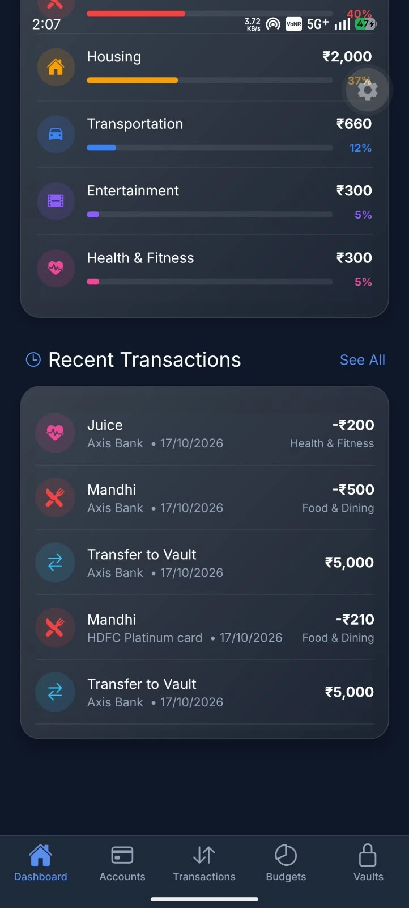
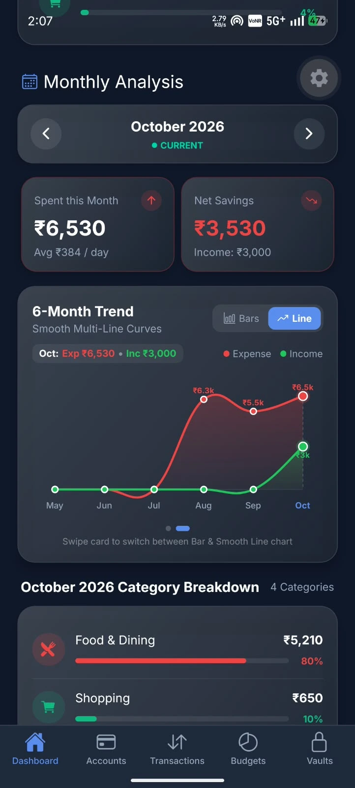
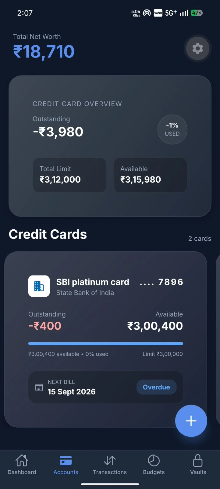
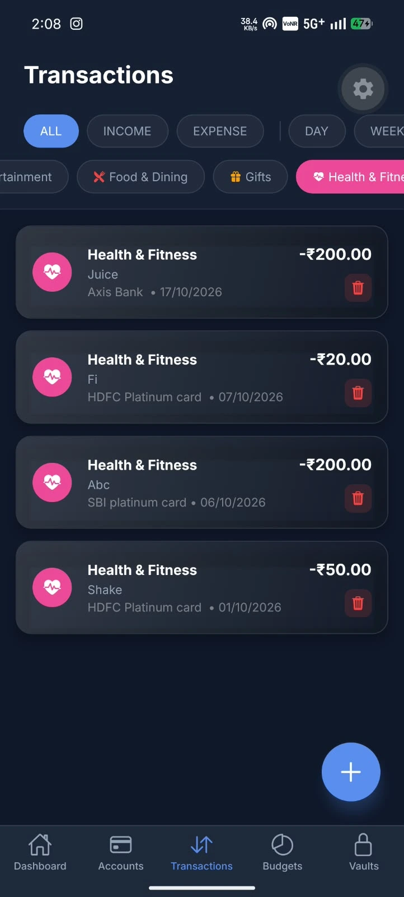
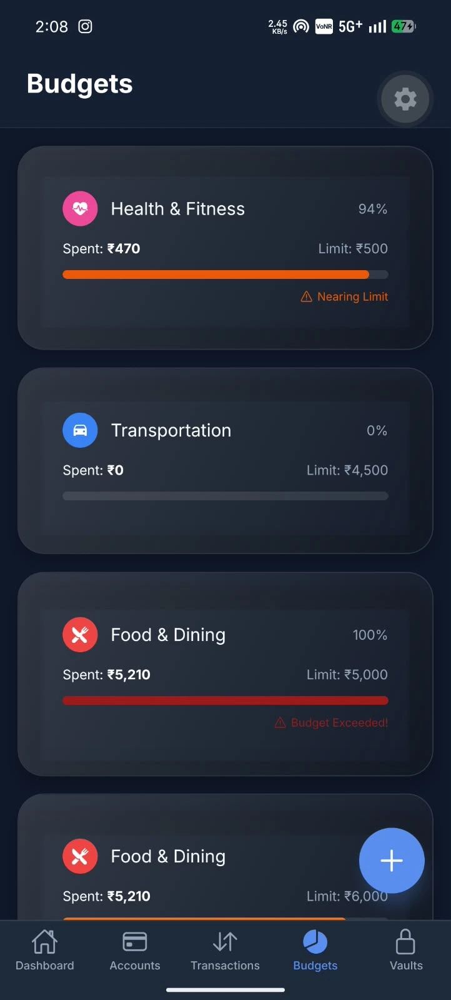
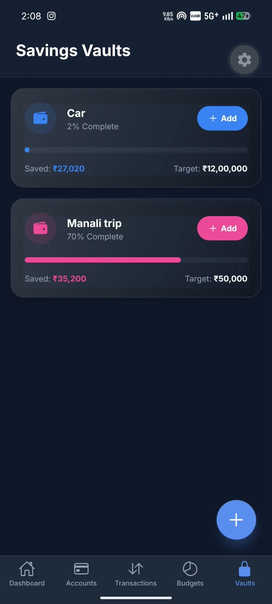

# 🏦 MoneyFlow — Smart Money & Expense Tracker

<div align="center">


### A modern, offline-first personal finance tracking application built with React Native and Expo.
Designed with rich glassmorphic aesthetics, multi-account net worth tracking, interactive hardware-accelerated charts, monthly analytics, goal-oriented savings vaults, and biometric security.

[](https://reactnative.dev/)
[](https://expo.dev/)
[](https://www.typescriptlang.org/)
[](https://docs.expo.dev/versions/latest/sdk/sqlite/)
[](https://www.nativewind.dev/)

---

### 🎥 Demo Video Walkthrough
[](https://drive.google.com/drive/folders/16DJuFaB3gbXBi846hmN3nHP8Ec4ftfi_?usp=sharing)

👉 **[Click here to watch the full project demonstration video on Google Drive](https://drive.google.com/drive/folders/16DJuFaB3gbXBi846hmN3nHP8Ec4ftfi_?usp=sharing)**

</div>

---

## 📱 App Screenshots

<div align="center">

| 📊 Dashboard & Analytics | 📈 6-Month Smooth Trend |
| :---: | :---: |
|  |  |

| 💳 Multi-Account & Cards | 💸 Transactions Manager |
| :---: | :---: |
|  |  |

| 🎯 Budgets & Thresholds | 🏦 Savings Goals & Vaults |
| :---: | :---: |
|  |  |

</div>

---

## ✨ Key Features

### 1. 📊 Smart Dashboard & Net Worth Center
- **Total Net Worth**: Live calculation of all balances across Cash, Bank, and Credit Cards with a privacy eye toggle (`••••••••`).
- **Monthly Income vs. Expense Split**: Side-by-side performance cards with trend indicators.
- **Savings Rate Calculation**: Dynamic savings percentage badge showing net surplus/deficit.
- **Quick Action Row**: Instant shortcuts for `+ Expense`, `+ Income`, `🎯 New Goal`, and `💳 Accounts`.
- **15-Day Bill Due Alerts**: Automatic detection and dismissable alert banner for credit card payment due dates.

### 2. 🥧 Interactive Expense Donut Chart
- **Hardware-Accelerated SVG**: Built with `react-native-svg` using native circle arcs with rounded segment caps.
- **Interactive Centerpiece Hub**: Shows top category spending by default; tapping any category in the list spotlights that category's slice and updates the center hub in real-time.
- **Timeframe Filters**: Seamless 1-tap switching across **WEEK**, **MONTH**, **YEAR**, and **ALL**.

### 3. 📈 Slideable 6-Month Trend (Bar & Smooth Multi-Line Curves)
- **Swipeable Carousel**: Horizontally swipe between the **Comparative Bar Chart** and the **Smooth Multi-Line Chart** with mode toggle buttons (`[ 📊 Bars ] [ 📈 Line ]`).
- **Smooth Bezier Splines**: Dual fluid curves for Income (emerald green) and Expense (rose/red) with soft gradient area fills.
- **Direct On-Chart Values**: Compact values (`₹5.2k`, `₹8k`, `₹2k`) rendered along the curve for instant comprehension.
- **Interactive Month Spotlight**: Tap any point to view exact figures and a vertical indicator guideline.

### 4. 🏦 Savings Goals & Vaults Carousel
- **Horizontal Snapping Slider**: Swipe through active savings goals with progress percentages and remaining amounts.
- **Instant "+ Add Money"**: Quick deposit shortcut on each card to transfer money from an account directly into a vault.
- **Goal Completion Celebrations**: Visual trophy badge when a target is 100% reached.

### 5. 💳 Account & Credit Card Management
- Manage multiple accounts: Cash, Checking, Savings, and Credit Cards.
- Credit limit tracking, outstanding balance, available credit, and bill due day alerts.

### 6. 💸 Comprehensive Transactions Management
- Record Income, Expenses, and Transfers with date pickers, custom categories, and notes.
- Automatic balance adjustments across linked accounts.

### 7. 🎯 Dynamic Budget Tracking
- Set category-specific limits (Monthly / Weekly).
- Visual progress bars with warning alerts when spending crosses 80% or 100% of the budget.

### 8. 🔒 Security & Offline Data Privacy
- **100% Offline-First**: Zero external server tracking; all financial data resides securely on the device via SQLite (`expo-sqlite`).
- **PIN Lock & Biometrics**: Custom PIN length (4–8 digits) and biometric authentication (Face ID / Fingerprint) via `expo-local-authentication`.
- **JSON Backup Export**: Export full database backups directly to your device storage.

---

## 🛠️ Tech Stack & Architecture

| Technology | Purpose |
| :--- | :--- |
| **React Native (0.86)** | Core mobile application framework |
| **Expo (SDK 57)** | Native runtime, development platform, and toolchain |
| **TypeScript (6.0)** | Type safety, maintainability, and clean interfaces |
| **NativeWind / TailwindCSS** | Utility-first styling and glassmorphism design system |
| **Expo Blur & Linear Gradient** | Glassmorphic visual effects and glowing cards |
| **react-native-svg** | High-performance vector charts and smooth curves |
| **SQLite (`expo-sqlite`)** | Robust local SQL database with repository pattern |
| **Zustand** | Predictable, reactive global state management |
| **React Hook Form + Zod** | Schema-based form validation and error handling |
| **Expo Secure Store** | Hardware-encrypted storage for PIN codes and auth keys |

---

## 📂 Project Directory Structure

```text
moneyflow/
├── assets/
│   ├── app-photos/             # High-resolution screenshots
│   │   ├── Dashboard.webp
│   │   ├── Dashboard_1.webp
│   │   ├── account.webp
│   │   ├── transaction.webp
│   │   ├── Budget.webp
│   │   └── valut.webp
│   ├── icon.png
│   └── splash-icon.png
├── src/
│   ├── components/             # Reusable UI kit
│   │   ├── common/             # Typography, GradientButton, ConfirmModal
│   │   ├── forms/              # Input, Select, DatePicker
│   │   └── glass/              # GlassCard with BlurView & LinearGradient
│   ├── database/               # Offline-first SQLite database
│   │   ├── connection.ts       # Database initialization & migrations
│   │   ├── schema.ts           # Data models (Accounts, Transactions, Vaults, Budgets)
│   │   └── repositories/       # CRUD logic for all entities
│   ├── features/               # Feature-based screen modules
│   │   ├── accounts/           # Accounts & Credit Cards screen and forms
│   │   ├── budgets/            # Budgets list and budget creator
│   │   ├── dashboard/          # Dashboard screen & modular widgets
│   │   │   └── components/
│   │   │       ├── ExpensePieChartSection.tsx  # SVG Donut chart & categories
│   │   │       ├── MonthExpenseSection.tsx     # Calendar analytics & slideable trend
│   │   │       └── SavingsGoalsCarousel.tsx    # Snapping vaults card slider
│   │   ├── settings/           # PIN setup, biometrics, export backup
│   │   ├── transactions/       # Transactions history and logger
│   │   └── vaults/             # Savings vaults & deposit modal
│   ├── navigation/             # Bottom Tabs & Stack navigation
│   ├── store/                  # Global Zustand finance state
│   └── theme/                  # Color tokens, typography, and constants
├── App.tsx                     # App entry point, DB init, & security gate
├── app.json                    # Expo configuration
├── package.json
└── tsconfig.json
```

---

## 🚀 Getting Started

### Prerequisites
- [Node.js](https://nodejs.org/) (v18 or newer recommended)
- [npm](https://www.npmjs.com/) or [yarn](https://yarnpkg.com/)
- [Expo Go](https://expo.dev/go) app on your mobile device (iOS or Android), or an active emulator.

### 1. Clone & Navigate
```bash
git clone https://github.com/AJNAS67/smart-money-tracker.git
cd smart-money-tracker/moneyflow
```

### 2. Install Dependencies
```bash
npm install
```

### 3. Start the Development Server
```bash
npm start
# or
npx expo start
```

### 4. Run on Device or Emulator
- **Physical Device**: Open the **Expo Go** app and scan the QR code displayed in the terminal.
- **Android Emulator**: Press **`a`** in the terminal, or run:
  ```bash
  npm run android
  ```
- **iOS Simulator** *(macOS only)*: Press **`i`** in the terminal, or run:
  ```bash
  npm run ios
  ```
- **Web Preview**: Press **`w`** in the terminal, or run:
  ```bash
  npm run web
  ```

---

## 📄 License
This project is licensed under the MIT License - see the [LICENSE](LICENSE) file for details.
